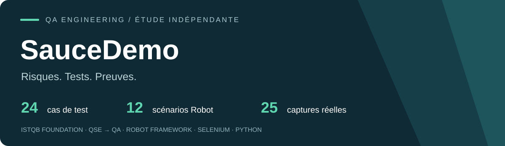

# Portfolio d’ingénieur QA freelance

**ISTQB Foundation · Reconversion QSE → QA · Tests fonctionnels et automatisation**

Une étude indépendante sur SauceDemo : transformer les risques d’un parcours e-commerce en tests traçables, puis apporter des preuves d’exécution. L’expérience QSE se traduit ici par la prévention des risques, la maîtrise des écarts et une restitution documentée. Cette étude a été préparée avec assistance IA ; elle ne représente pas une mission client.

**Preuves du 16 octobre 2026 : 12/12 scénarios Robot passants + 12/12 contrôles complémentaires assistés Selenium.** Les 24 cas conçus ont été vérifiés dans Chrome sur Windows. Aucune exécution CI, aucun import Xray et aucune validation métier ne sont prétendus.

## À consulter en deux minutes

| Pour comprendre… | Ouvrir |
|---|---|
| La démarche et les résultats | [Synthèse client PDF](docs/portfolio-qa.pdf) |
| Les résultats réellement obtenus et leurs limites | [Bilan d’exécution](docs/execution-report.md) · [Rapport Robot](evidence/2026-10-16/robot/report.html) |
| Les choix de test | [Stratégie par les risques](docs/test-strategy.md) · [Plan de test](docs/test-plan.md) |
| La couverture | [24 cas détaillés](docs/test-cases.md) · [Matrice de traçabilité](docs/traceability.md) |
| Le code | [Suite Robot](tests/ui/saucedemo.robot) · [Architecture POM](docs/architecture.md) |
| La publication | [Guide GitHub](docs/publish-github.md) |

Sur GitHub, les rapports HTML se téléchargent puis s’ouvrent localement dans un navigateur. Aucun lien de badge « CI passing » n’est affiché avant une véritable exécution distante.

## Ce que le projet démontre

- Analyse des risques : 8 risques, 14 hypothèses métier identifiées comme telles, priorisation et risques résiduels.
- Conception : 24 cas, partitions d’équivalence, transitions et contrôles de cohérence ; données publiques et synthétiques.
- Automatisation : 12 scénarios Robot Framework + SeleniumLibrary ; POM en resource files, isolation de session, attentes explicites, calculs monétaires Python avec Decimal.
- Intégration : GitHub Actions et Jenkinsfile préparés ; mapping Jira/Xray et CSV de cas sans clé fictive.
- Restitution : résultats d’origine, 25 captures, historique des erreurs du harnais, bilan et synthèse client.

## Installer et exécuter

Prérequis : **Python 3.12**, Google Chrome installé, accès à PyPI, SauceDemo et aux téléchargements ChromeDriver. Git est utile pour publier. La suite n’exige ni compte Sauce Labs, ni abonnement, ni vrai secret. La version du navigateur et du pilote est consignée à chaque exécution ; requirements.txt fige les dépendances Python, pas le système.

Dans le dossier du projet, sous Windows PowerShell :

```powershell
py -3.12 -m venv .venv
.\.venv\Scripts\python.exe -m pip install -r requirements.txt
.\.venv\Scripts\python.exe -m pip check
.\.venv\Scripts\python.exe scripts/validate_portfolio.py
.\.venv\Scripts\python.exe scripts/run.py --suite smoke
.\.venv\Scripts\python.exe scripts/run.py --suite regression
```

Sous Linux/macOS (installer Chrome selon le système) :

```bash
python3.12 -m venv .venv
.venv/bin/python -m pip install -r requirements.txt
.venv/bin/python -m pip check
.venv/bin/python scripts/validate_portfolio.py
.venv/bin/python scripts/run.py --suite regression
```

Le lanceur crée un dossier horodaté dans results/ et renvoie le code d’échec Robot à l’appelant. Pour choisir le dossier, ajouter `--output results/ma-campagne` avec un chemin encore vide. Ouvrir ensuite son report.html et son log.html. Générer la synthèse factuelle avec `python scripts/summarize.py results/ma-campagne` en utilisant le même interpréteur virtuel.

Vérification sans navigateur : `python scripts/run.py --dry-run --output results/dry-run-unique`. **Un dry-run ne teste pas l’application** et ne doit pas être présenté comme une campagne réussie. Le lanceur refuse de remplacer un dossier non vide.

Les oracles monétaires et les règles de configuration sont aussi vérifiables sans navigateur : `python -m unittest discover -s tests/unit -v` (9 tests unitaires, distincts des 24 cas fonctionnels).

## Configuration et dépannage

Les valeurs par défaut sont les comptes publics affichés par SauceDemo. `.env.example` documente les variables mais n’est pas chargé automatiquement.

```powershell
$env:SD_HEADLESS = 'false'     # montrer le navigateur de test
$env:SD_TIMEOUT = '15'         # attente explicite, 1 à 60 secondes
.\.venv\Scripts\python.exe scripts/run.py --suite smoke
```

`SD_BASE_URL`, `SD_USERNAME`, `SD_PASSWORD` et `SD_LOCKED_USERNAME` permettent une configuration par environnement. La cible est restreinte au site de démo, son miroir officiel et localhost. Ne pas utiliser de vrais comptes : les mots-clés de niveau supérieur et captures peuvent conserver des données, malgré Input Password. Aucun token GitHub/Xray n’est nécessaire à l’exécution locale.

Selenium Manager résout le pilote au premier lancement. Si le réseau de l’entreprise le bloque, fournir `SD_BROWSER_BINARY` et `SD_DRIVER_PATH` vers les exécutables compatibles, ou configurer le proxy Selenium Manager suivant sa documentation officielle. Ne pas désactiver la validation TLS. `SE_CACHE_PATH` choisit le cache ; `SE_AVOID_STATS=true` désactive les statistiques du gestionnaire. Un échec d’ouverture du navigateur est un incident d’environnement à diagnostiquer dans log.html.

## Organisation

```text
tests/ui/             12 scénarios de régression maintenus
resources/pages/      Page Objects connexion, catalogue, panier, checkout
libraries/            navigateur isolé, oracles Decimal, preuve de contexte
variables/            configuration validée
scripts/              exécution, validation et synthèse
docs/                 stratégie, plan, cas, matrice, campagnes, bilan, PDF
integrations/xray/    cas CSV et mapping préparés
evidence/             preuves réelles datées et historique de mise au point
.github/workflows/    CI GitHub Actions préparée
Jenkinsfile           pipeline Linux préparé
```

Les douze cas complémentaires, conçus pour une revue fonctionnelle, ont été exécutés par un protocole ponctuel Selenium archivé avec leurs preuves. Ce protocole n’est pas une seconde suite Robot maintenue ni une recette humaine.

## Limites et transparence

Toutes les règles H-xx sont des **hypothèses inférées**, sans spécification approuvée. Les 24 PASS attestent des assertions définies sur une version publique à une date donnée. Ils ne prouvent pas la conformité métier, la sécurité, la performance, l’accessibilité exhaustive ou la compatibilité tous navigateurs. Le taux de taxe de 8 % est un oracle propre à la démo.

Aucun ticket produit n’a été créé sans écart observé. Les deux tentatives de mise au point conservées concernent le code de test. [Le registre](docs/defects/README.md) explique les règles de qualification. La certification et le parcours professionnel sont des informations fournies par le propriétaire, sans identifiant inventé.

Le dépôt reste local, prêt à publier sous **QA-Portfolio-SauceDemo**. GitHub Actions, Jenkins et Xray sont préparés et documentés ; leur exécution réelle dépend des comptes et instances. [Publier sur GitHub](docs/publish-github.md) est la seule étape nécessaire pour obtenir un lien public. [Guide de démonstration](docs/demo-guide.md) pour présenter l’étude en trois minutes.

## Sources et droits

[SauceDemo](https://www.saucedemo.com/) et son [dépôt officiel](https://github.com/saucelabs/sample-app-web) sont des ressources Sauce Labs. Le code source officiel est sous [licence MIT](https://raw.githubusercontent.com/saucelabs/sample-app-web/main/LICENSE). Les conditions, constats de disponibilité et limites sont détaillés dans [sources-and-scope.md](docs/sources-and-scope.md).

Étude indépendante, non affiliée à Sauce Labs. Aucun contenu d’un projet de formation non autorisé n’est réutilisé. [Licence](LICENSE) du code et des documents originaux de ce portfolio ; les marques et écrans de tiers conservent leurs droits.
